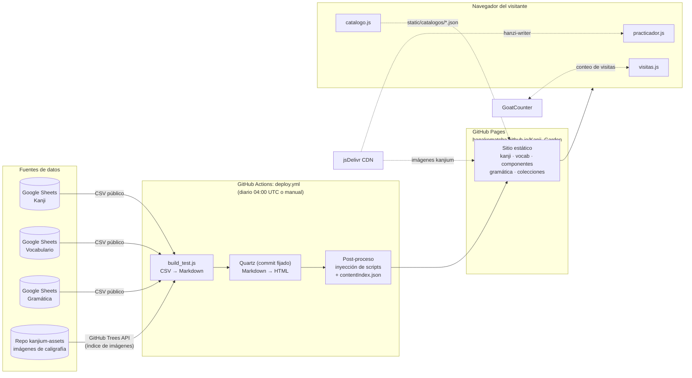
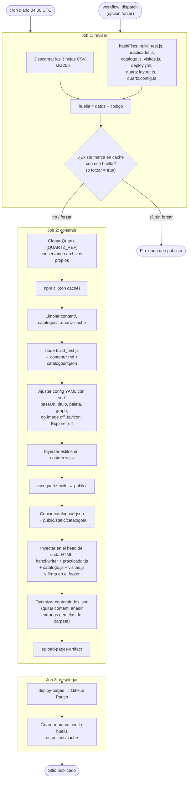
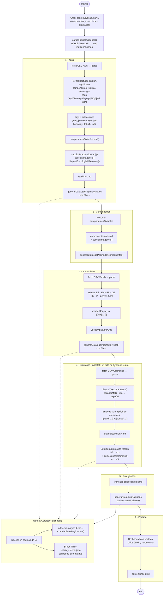
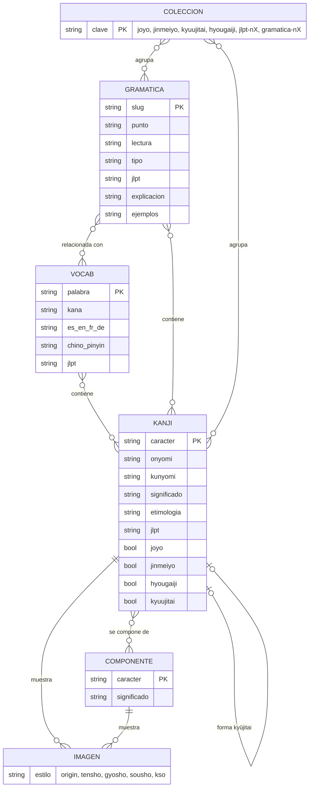
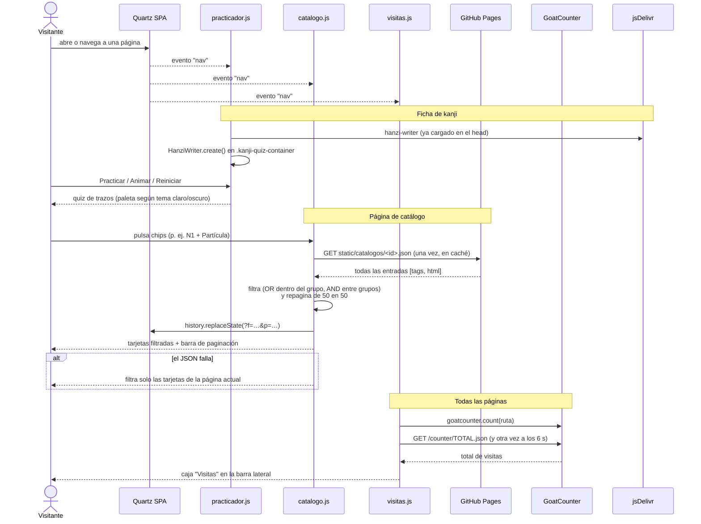
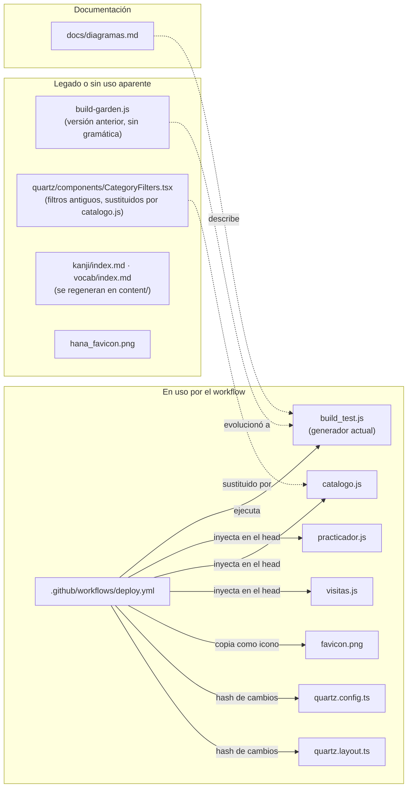

# Kanji Garden: diagramas del proyecto

Seis diagramas, de lo general a lo concreto:

1. [Arquitectura general](#1-arquitectura-general): de dónde salen los datos y adónde llegan
2. [Despliegue (GitHub Actions)](#2-despliegue-github-actions-deployyml): `deploy.yml`, paso a paso
3. [Pipeline de generación](#3-pipeline-de-generación-build_testjs): qué hace `build_test.js`
4. [Modelo de contenido](#4-modelo-de-contenido-y-enlaces-del-grafo): tipos de página y cómo se enlazan
5. [Comportamiento en el navegador](#5-comportamiento-en-el-navegador-scripts-inyectados): los tres scripts inyectados
6. [Mapa del repositorio](#6-mapa-del-repositorio): qué archivo se usa y cuál es legado

---

## 1. Arquitectura general

---

## 2. Despliegue (GitHub Actions: `deploy.yml`)

Tres jobs. El primero calcula una huella (hojas + código) y evita reconstruir si nada ha cambiado.

---

## 3. Pipeline de generación (`build_test.js`)

Refleja el generador actual: incluye gramática, las colecciones Kyūjitai/Hyōgaiji y los JSON de catálogo.

Todas las escrituras pasan por `escribirSiCambio()`, que solo toca el disco si el contenido ha cambiado.

---

## 4. Modelo de contenido y enlaces del grafo

Tipos de página que genera el build y los wikilinks entre ellas (son los que dibujan el grafo y los backlinks de Quartz).

---

## 5. Comportamiento en el navegador (scripts inyectados)

Los tres scripts se inyectan con `data-persist` para sobrevivir a la navegación SPA de Quartz y se reactivan con el evento `nav`.

---

## 6. Mapa del repositorio

